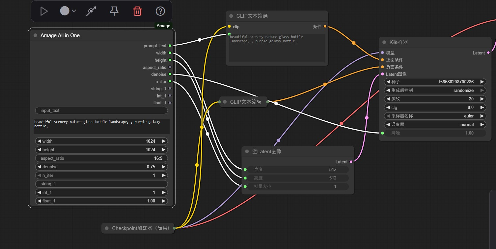
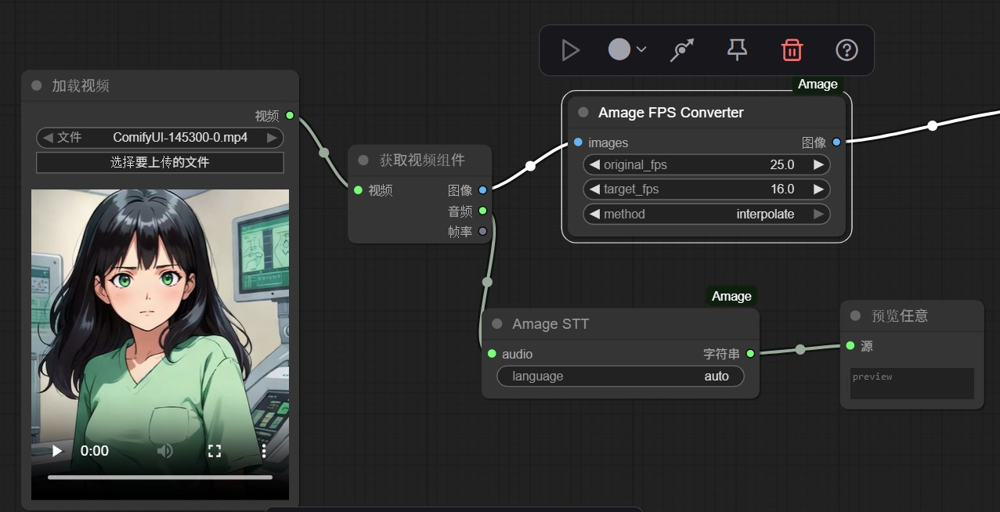

# Amage ComfyUI Custom Nodes

This repository provides a set of custom nodes for
[ComfyUI](https://github.com/comfyanonymous/ComfyUI), designed to
improve workflow convenience when working with text, image, video, and
audio data.

## 📦 Nodes Overview

### 1. Amage Text (`AmageTextNode`)

A simple text input node.
- Allows users to add prompt texts or other strings.
- Provides an `input_text` field to concatenate extra text into the
node.
- A typical use case is adding LoRA trigger words in front of the main
prompt.

### 2. Amage All in One (`AmageOneNode`)

An extended version of the text node that bundles multiple generation
parameters into one place.
- Centralizes common inputs needed for AI image or video generation,
such as:
- Prompt text
- Image width & height
- Aspect ratio
- Denoise value
- Iteration count
- Includes three customizable inputs (string, integer, float) for more
flexible usage.
- Each parameter is also available as an individual output.

### 3. Amage FPS Converter (`AmageFpsConverterNode`)

A video utility node for adjusting frame rate (FPS).
- Inputs: `original_fps`, `target_fps`, and `method`.
- Methods available:
- **downsample** (reduce FPS by skipping frames)
- **duplicate** (increase FPS by repeating frames)
- **interpolate** (smoothly increase FPS by interpolating frames)

### 4. Amage STT (`AmageSTTNode`)

A speech-to-text (STT) node powered by
[Whisper](https://github.com/openai/whisper).
- Converts input audio into text.
- Automatically searches for the model at:
`models/sonic/whisper-medium`
- Supports automatic language detection (`language="auto"`) or manual
specification.

### 5. Amage VRAM Cleaner (`AmageVramCleanerNode`)

A utility node for releasing GPU VRAM during a workflow.
- Unloads models tracked by ComfyUI, clears available CUDA cache, and runs
  Python garbage collection.
- Passes its input through to the output, so it can be placed between
  workflow stages without interrupting the data connection.
- Provides an optional `label` input for identifying cleanup operations in
  the console log.

### 6. Amage Text Converter (`AmageTextConvertNode`)

A text conversion and translation node. Select one of the following modes:
- `t2s (繁轉簡)` — converts Traditional Chinese to Simplified Chinese.
- `s2t (簡轉繁)` — converts Simplified Chinese to Traditional Chinese.
- `zh-en (中翻英)` — translates Chinese to English.
- `en-zh (英翻中)` — translates English to Chinese.

Chinese script conversion requires OpenCC (`opencc-python-reimplemented`).
Chinese-English translation uses Google Translate through `deep-translator`
and requires an internet connection. Install both packages in the same
Python environment used by ComfyUI:

```bash
python -m pip install opencc-python-reimplemented deep-translator
```

---

## 📸 Screenshots
Here are some examples of the nodes inside ComfyUI:

### Amage Text & Amage All in One


### Amage FPS Converter & Amage STT


---

## 🔧 Installation

1.  Clone or download this repository into your ComfyUI `custom_nodes`
    folder:

    ``` bash
    git clone https://github.com/Sampkao/Amage.git
    ```

2.  Restart ComfyUI.

3.  The nodes will appear under categories including **Amage/Audio**,
    **Amage/Video**, **Amage/Utils**, **Amage/Text**, and **Text**.

------------------------------------------------------------------------

## 📜 License

MIT License. Feel free to use, modify, and share.
